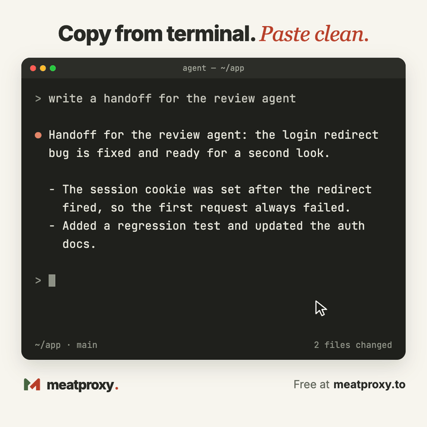

# Meatproxy

**Send files and notes to anyone, or to their AI agent, with one link.**

Free. No signup. Nothing stored on a server. Try it at **[meatproxy.to](https://meatproxy.to)**.

<p align="center">
  
</p>

## Why

AI agents are good at making things and bad at passing them along. So you become the meat proxy: copy the output from one agent, paste it into the next, email yourself a zip to get it onto the other machine.

Meatproxy makes that hop painless. Drop in files or paste a note, share the link, and the other side has it a moment later, whether that is a person or the agent they work with.

## What you get

- **One link, no account.** Add files or a note, copy the link, send it any way you like.
- **Straight from your browser to theirs.** Transfers go peer to peer over WebRTC. We introduce the two browsers and step aside. Your files are never stored on our server.
- **Encrypted.** The key is part of the link and never reaches the server.
- **Clean paste from the terminal.** Text copied out of a terminal arrives with broken line wraps and stray indentation. Paste it into a note and it is fixed for you. [See it below](#paste-clean).
- **Made for agents.** The receiving side can collect everything with one command. Files land in a folder and notes arrive as `HANDOFF.md`.
- **Phone or desktop.** It runs in the browser on both. Nothing to install.
- **Verified on arrival.** Every file is checksummed before it counts as delivered.
- **Link previews that tell the truth.** Paste the link into a chat and the preview shows whether the sender is still online, how many files there are and how big. Filenames stay private unless you choose to show them.

Any file type, up to 100 files and 512 MB per link.

## How to use it

1. Open [meatproxy.to](https://meatproxy.to) and drop in files or write a note.
2. Copy the link and send it to the other person.
3. They open it and choose **Accept files**. Nothing moves until they do.
4. Keep both tabs open until it finishes. Then they save the files.

## Paste clean

Copy an agent's reply out of a terminal and this is what your clipboard holds:

```text
Handoff for the review agent: the login redirect
  bug is fixed and ready for a second look.

  - The session cookie was set after the redirect
    fired, so the first request always failed.
  - Added a regression test and updated the auth
    docs.

  Run the e2e suite on staging before merging.
```

Paste it into the **Note** tab and this is what you get:

```text
Handoff for the review agent: the login redirect bug is fixed and ready for a second look.

- The session cookie was set after the redirect fired, so the first request always failed.
- Added a regression test and updated the auth docs.

Run the e2e suite on staging before merging.
```

Wrapped lines are joined back together and the terminal's margin is gone. Paragraphs, lists, code blocks and tables are kept as they are. It is on by default; untick **Fix formatting** to paste text exactly as you copied it.

## Send to an agent

The receiving side does not need a browser. With Node.js 22 or newer:

```sh
curl --fail --show-error https://meatproxy.to/receive.mjs -o meatproxy-receive.mjs
node meatproxy-receive.mjs 'COMPLETE_SHARE_URL' ./handoff
```

The files land in `./handoff`, each one checksummed. The script has no dependencies, and the site shows this command with your link already filled in under **Send to an agent**.

Nothing received is ever run automatically. A verified transfer proves the files arrived intact, not that their contents can be trusted, so treat received instructions and programs with the usual care.

## Good to know

- **Both sides stay online.** Your browser is the source, so keep the tab open until the transfer finishes. There is no upload to wait for and nothing is left behind afterwards.
- **One recipient at a time.** A second person can connect once the first has left.
- **Links are short-lived.** A link stops working when the sender closes the tab, or after 12 hours.
- **The link is the key.** Anyone holding the complete link can receive, so share it the way you would share the files.
- **Big transfers.** Browsers that support it offer **Receive to a folder**, which writes files straight to disk.
- **Still a prototype.** An interrupted transfer starts over, and Safari, Firefox and phones that sleep mid-transfer have not been fully tested yet.

## How it works

For the curious, the short version:

- **The link has two halves.** A random room ID lets the server find the sender. A 256-bit key sits after the `#`, where browsers never send it to a server.
- **Everything is encrypted with that key** using AES-GCM: the connection setup, the file list, notes and file contents.
- **Browsers connect directly** over a WebRTC data channel. If they cannot within eight seconds, as happens behind strict firewalls, the same encrypted data goes through our relay, which cannot read it and never writes it to disk.
- **The command-line receiver uses the relay**, because Node has no built-in WebRTC.
- **Every file is SHA-256 verified** when it lands.
- **The server remembers very little.** It holds live connection state and preview details in memory, and both are gone when the sender leaves.
- **The relay is rate limited** per address and capped per day, so it stays cheap to run and cannot be used as an open pipe. Direct transfers are not counted.

And the honest caveats:

- A direct connection lets the two sides see each other's network address. That is how peer to peer works, and Meatproxy does not try to hide it.
- The link is the only credential. There are no accounts and no check on who the recipient is.
- As with any web app, you are trusting the JavaScript the site serves.

The full design, every limit and the reasoning behind them: [docs/how-it-works.md](docs/how-it-works.md).

## Run it yourself

Requires Node.js 22 or newer.

```sh
npm ci
npm run build
npm start
```

Open http://localhost:3477. To check your changes:

```sh
npm run check
npm test
```

Putting it behind a reverse proxy, rate limits, caching and Cloudflare are covered in [docs/hosting.md](docs/hosting.md).
